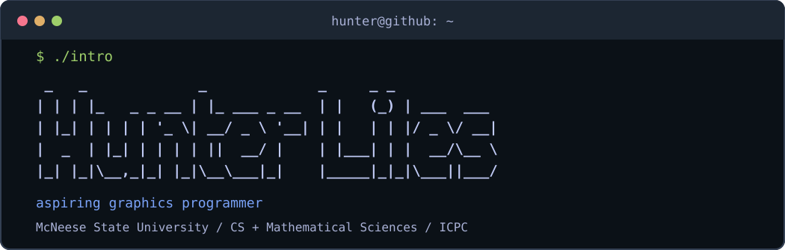

### `whoami`

I'm a student at **McNeese State University** studying
**Computer Science and Mathematical Sciences**.

My interests are in computer graphics; how they work and how to optimize them. I primarily make game engines to learn the graphics pipeline. I currently am an undergraduate researcher studying raymarching Signed Distance Fields and how to optimize them.

[Portfolio](https://hunter-liles.com)

#### `cat ~/about.conf`

```ini
[education]
university = McNeese State University
fields = Computer Science, Mathematical Sciences

[interests]
graphics = Vulkan, OpenGL, Raymarching, Rasterization
systems = C, C++, Rust, Linux
```

#### `cat ~/experience.log`

- **ICPC** — Competitive programming participant
- **Undergraduate Research** — SDF raymarching and rendering optimization

#### `ls ~/projects`

- [Vulkan Raymarcher](https://github.com/HunterLiles/blossom) — Experimenting with SDF rendering.
- [CPU Rasterizer](https://github.com/HunterLiles/software-renderer) — Exploring the graphics pipeline in software.
- [SDF Undergraduate Research](https://github.com/daneboyd20001/SRPLightingEngine) — Research into signed-distance-field rendering and optimizations.

